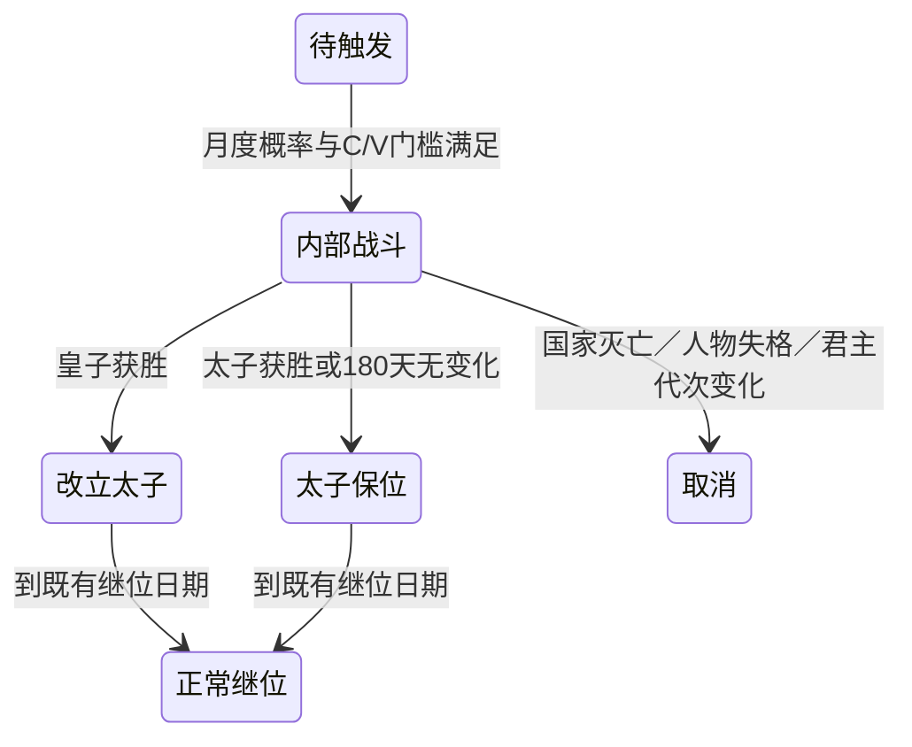

# Atlas 家谱与内部夺嫡

入口是 `atlas_military.tscn`。国家卡片的“家族树”及君主、继承人链接打开独立面板。打开不暂停模拟，不切换操控国或行军目标；同族国家选择只改变家谱查看对象，人物详情中的国家链接才打开国家卡片。

面板采用原生 Godot 控件和 Canvas 绘制。血缘结构由 `family_model.gd` 只读冻结；`family_layout.gd` 使用轮廓压紧与最近即位后裔对齐主干；`family_canvas.gd` 缓存布局、连线和空间索引。已任君主实框，宗室虚框，选中人蓝框，在位君主蓝色“当前”；灭亡国家不显示在位标记。未知生卒、年龄和任期不推造。

1280×720显示国家列表、谱图和人物详情三列；900×600使用顶部国家选择及谱图／详情切换。滚轮缩放，左键或中键拖动，查找按姓名／编号稳定循环，父子链接导航。“全谱”适配所有人物，“当前”定位并放大到可读尺寸。关闭后不再布局或绘制。空格沿用全局暂停规则。

## 内部战斗

只在既有和平、合法皇子与太子、未封闭竞争等条件下按月尝试，概率仍为人物掌军档对应的3%／1%／0%。所有本国存活真实军队按人物ID统计实际兵力，包括在途部队；中央直属与虚拟守军不参与。皇子C必须大于0并达到 `ceil(V×m)`，征服者m=0.5，其余1.0。没有合法太子不启动。

起事立即复制双方部队，冻结兵力、士气、补给／支付率及人物攻防修正。副本的FIELD战斗使用现有Combat规则6、无道路正面15000；独立编号与随机域，不进入地图战斗、道路、战团或国家集合。次日起每天一轮，同步与分帧共享函数及日期防重入。副本不增援、不再扣粮钱；伤亡不影响真实部队。

皇子胜只改太子，关闭本代竞争并按既有规则收回政治军权；太子胜处理挑战者死亡、爵位与军权，真实士兵存活。取消不产生政治胜负。到期继位遇到活跃战斗会延期。国家卡片展示双方人物、虚拟人数、士气、回合、延期及最近编年史结果，明确说明伤亡不会影响真实军队。

旧代理国家、府易主、营地行军、真实军队败亡与外部战场的夺嫡结算入口已移除。数据模型中旧地图字段只保留未绑定值以兼容查询接口，不能生成新地图夺嫡。普通战争、叛乱与削藩继续使用地图战斗。

## 记录与版本

Native运行快照28保存内部Battle、副本、固定骰子、回合、结果、日期与独立编号计数；27明确拒绝。`SuccessionConflict.from_snapshot()`恢复独立副本，不查真实军队。内部日志带`internal_succession`上下文，使用既有CombatLog回放。地图模板与Combat规则6不变。

家谱与国家卡片在日提交边界读取；日结算中保留上一份卡片，禁用编辑。历史家谱使用历史人物、爵号与编年史，内部战斗进度取历史已冻结的皇子报告。UI读取不调用生成子嗣、授爵、晋帝或继位入口。

历史国家卡片保留已经记录的“继承与王爵”；没有记录的经济与地图战役继续省略。人物中的国家链接明确进入国家卡片，同族列表切换只改变家谱观察对象。

## 代码图谱

| 模块 | 职责与下游 |
|---|---|
| `SuccessionRules.proposal/begin_preparation/advance/finish` | 门槛、冻结副本、逐日Combat、既有政治结果 |
| `Simulation._propose/_update_succession_conflicts` | 月度尝试、共享日推进、到期继位延期 |
| `SuccessionConflict` | 私有Battle、回合日志、只读进度、快照恢复 |
| `NativeSnapshotBuilder` | schema28、内部战斗序列化与兼容拒绝 |
| `PrincePolitics.report`／政治历史 | 当前及历史夺嫡展示，不抽调真实军队 |
| `family_model` → `family_layout` → `family_canvas` | 只读人物 → 血缘几何 → 可见绘制 |
| `family_panel`／`information_model` | 国家、人物与谱图入口；不调用政治写接口 |

## 回归说明

`ruler_succession_extremes`原有两项失败已修复：旧网格按城市分国，测试却假设全州完整归属。分封身份与连续分封用例现在先通过真实领土事务建立完整州域，保留既有自然生育和不分封残缺州的规则。此前在隔离的352b4e7上验证了相同失败。

长跑另发现：领土灭亡而未整国兼并的国家遗留开放爵位档案。`RoyalTitles.reconcile`现在以家谱与领土版本共同失效，关闭灭亡授爵机构的现行爵位，记录`institution_extinct`，不迁移人物、不改变生死或其他国家的爵位；新增真实领土事务回归。

专项覆盖双方胜负、普通／征服者门槛、零兵太子、无太子、取消、180天停滞、延期继位、战斗副本恢复及日志回放。运行期测试逐日比较同步／分帧与打开家谱的完整Native状态和随机流；布局测试覆盖5000人物、25代及无重叠。实机脚本为`tests/atlas_family_visual.gd`和`tests/atlas_family_canvas_gpu.gd`，需使用真实渲染器运行，不加入headless测试组。实际测试、截图、长跑版本与限制见 [验收记录](FAMILY_SUCCESSION_VALIDATION.md)。

## 来源

家谱布局与样式参考 civ-atlas `103afd3d998eac6750692a6813bf5aea03521448` 的 `src/gen/civ/lineageInfo.ts`、`src/ui/PeopleLineage.tsx`、`src/ui/overview.css`。沿用已有AGPL-3.0-only声明与字体许可，见 `assets/atlas/NOTICE.md`。运行程序不使用TypeScript或浏览器。
