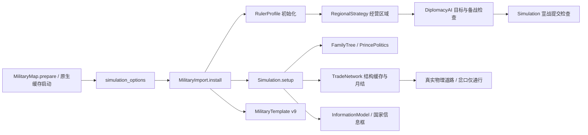

# Atlas 贸易与君主接入

2026-10-10：默认真实地球种子1、40国，北纬20°～55°、西经15°～东经145°欧亚遮罩。新局使用已有 `TradeNetwork`、`RulerProfile`、`FamilyTree`、`PrincePolitics` 和 `RegionalStrategy`，不改变气候、城市、州府、道路及初始州预算。

## 行为与兼容

- 原贸易规则是区域贸易中心之间的路线及税收；战争不拆路或封锁贸易，只降低参战国到账贸易金。当前原系统的粮食与人口贸易结算为零，本次没有另造粮食买卖规则。
- 真实交通岔口允许寻路，但无政治、税源或贸易中心身份。沿线税收按道路实际控制辖区归真实治所；同一治所只分配一次。交通分段采用精确距离与可加费用，避免岔口数量提高运输成本。海运保持关闭。
- 君主类型、特质、政策与姓名由已有稳定哈希初始化，启用家族、继位和原有国政／军事倍率。国家信息框展示君主、政策、经营区域锚点和整合进度。
- 经营区域是现有治所战略图的社区，州内府跟随州治区域；不等于单个州。主动扩张在目标筛选、备战和宣战提交中均使用原有区域检查。法理收复、宗藩内战及已有防御反攻例外保留，手动宣战不新增区域限制。整合完成后按已有君主规则选择下一邻接区域。
- `simulation_options.trade_enabled/rulers_enabled` 随 Atlas 布局保存。原生新局与启动缓存使用启用配置；版本9旧模板缺少配置时仍按军事／中性君主流程加载。新模板保存当前君主身份、特质、政策及经营区域锚点，用作新局起点；任期和家族按新局初始化，不是战役存档。历史信息仍只展示已记录的政治信息，不展示当前经济数据。

## 接入路径／代码图谱索引

## 验证范围

后续年度商路缓存与分批轮换已接入，规则及证据见 [ANNUAL_TRADE_ROUTES.md](ANNUAL_TRADE_ROUTES.md)。国界变化保留物理商路，仅更新当前税收归属；静态财政预测也共用缓存。

`atlas_politics_trade.gd` 使用实际欧亚布局：484治所、1192节点、25战略区域、153初始贸易路线。验证区域外备战与宣战拒绝、真实岔口通行、第三国过境税、无虚假区域、分段成本、贸易不消耗随机流、家族初始化、实际继位入口、模板开关／君主往返及旧模板兼容；运行35天并审计领土、战团和交通点经济身份。

同时复跑原贸易／区域／家族回归、Atlas 模板、信息框、启动缓存和军事烟测。双方胜利／被宣战方反攻灭国沿用真实事务回归 `atlas_territory_transactions`、`war_count_and_conqueror`、`succession_counterattack`。综合测试505通过、0失败。

验证日志及实际GPU信息框截图见 `evidence/politics_trade/`。此轮短程验证不代表完成新版30年稳定性审计；先前正在运行的全球军事审计加载了旧代码，不能用来证明本次启用的贸易和君主行为。
