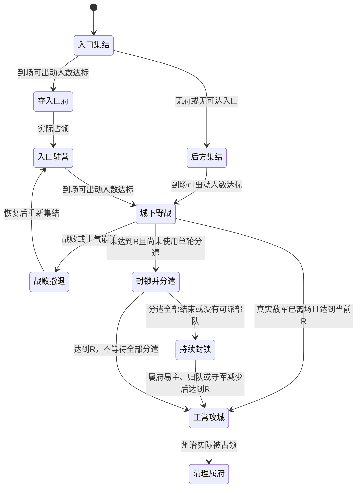
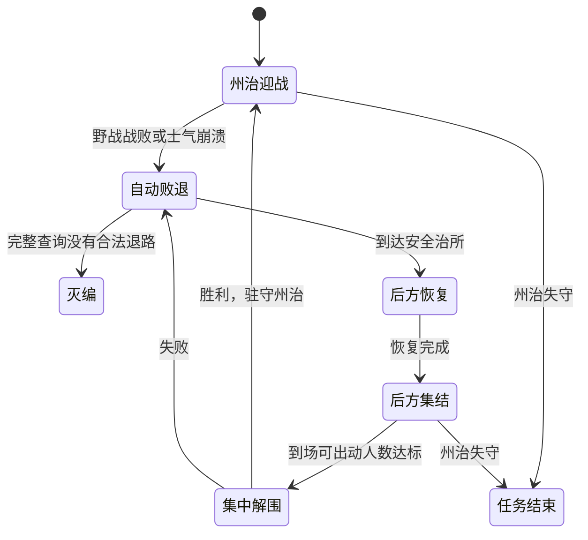

# Atlas 单轮攻府与后方解围

2026-10-12，基于 `a71932a7d69bf1ed284cc18ed7e7b6f12a791914` 的未提交工作区。保留此前补给、分封与界面修改。本轮只改变军事调度及其记录、展示，不改地图生成、道路或贸易规则。

源码与测试集成提交：`1c054f4`。推送前补跑君主编辑、藩属边界、365天自然分封与分封连通4项回归，全部通过；摘要与压缩日志见 `evidence/simple_campaign/prepush-*`。此前35项回归摘要保留，不被补测覆盖。

## 规则

虚拟守军独立攻击倍率为0.1，真实驻防仍为0.5。攻城准入读取现场实际人数，补给影响攻防属性。普通／征服者野战出动仍需严格超过0.9V／0.45V；在途和恢复部队不算到场兵力。

入口固定。未到城下野战结束时不分遣占其余府。封锁时留住最大合格部队，其余现有部队各执行一个固定府任务；不足就少派，不拆编、不新建、不补派。目标占领或失效后在当日安全调度点下令返回；无路、战败或手动接管则结束任务。正常攻城和真实野战不能抽兵。

后方点是最近可达、未被围的真实治所，本国优先，其次有军事通行权的友方。交通点只能作为中继。点有效时固定；失效后重选。共同点对某支败军不可达时，该军自行找安全落点；无路才灭编。援军先送后方，达到门槛才集中解围；已出发队伍不会因后方人数下降被改令。无府州、末首都和孤岛共用这一退路规则。

## 实现与记录

- `scripts/simulation/rules/simple_campaign.gd` 集中派生野战／封锁／攻城状态、分遣任务及后方集结。
- `Simulation` 在当日移动与战斗完成后的安全点检查归队和单轮分遣；常规兵力分配仍走原战略批次。日检查不重规划全部军队路径。
- `GameState.campaign_raid_records` 以战争、目标州及参与阵营记录使用情况，并持有任务。战线重建恢复原任务，战争合并迁移记录，战争结束或本阵营取得州治后清理。
- 分遣军的战役、战争身份保留；分配器不能抽走正在出征或归队的分遣军。手动命令接管后取消对应任务。
- 接壤只提供入口候选。Atlas集结点必须沿完整实际道路可达目标；以领土、外交和道路版本缓存验证。入口固定后失效不换其他府，转直接州治流程；该流程仍不得穿越无权限领土。种子1第330／450／540天的旧停滞候选因此被定位为粗接壤与实际权限不一致，而非兵力不足。
- 新阶段追加到旧枚举末尾。国家卡片显示阶段、集结点和出征／归队／结束数量。
- Combat规则6、Native运行快照27。规则5战斗日志、Schema26运行快照拒绝按新规则使用；静态地图模板不变。

## 验证记录

最终验收结果及实际输入、源码哈希、耗时、截图统一写入 `evidence/simple_campaign/`。中间版本的720天通过记录不能替代最终版。同步与分帧比较覆盖战线及战场对编号、任务、绑定、物理路径、部队属性、驻防落点、外交、资源和随机流，不归一化编号。

对照最初暴露第120天战场对编号不同、第150天战线编号不同、第300天预备队415／416／417有不同调令。原因是同步外交提交会立即启动攻势，分帧则在当日AI阶段统一启动。同步外交现也采用同一延期启动入口，直接提交单条命令的既有接口保留。修复后365天严格逐日比较通过，没有靠忽略编号通过测试。RED轨迹保留在 `.dbg/campaign-simple-baseline/red-*-day300.*`。

最终回归35项、0失败，其中综合断言505项通过。覆盖围城、战役、联盟、补给、守军经济、君主、模板／快照、真实领土事务及编译；`atlas_territory_transactions` 的126项检查包含主动方胜利及被宣战方反攻兼并宣战方。种子1同步／分帧365天严格逐日比较通过。完整回归摘要与日志压缩件已保存在本目录证据中。以上记录对应提交前工作区；2026-10-12用户随后明确要求提交并推送当前集成检查点，已知通路限制仍保留。

三次独立、顺序执行的最终版headless长跑均完成目标天数，未发现军队位置／战斗及战役绑定／道路占用／库存／国家存亡审计硬错误。180天状态不变只登记为候选，不能等同于已证实死循环。三局实际生成参数均为真实地球、40国、欧亚遮罩北纬20～55度、西经15～东经145度，贸易和君主开启。游戏年360天。

| 种子 | 完成天数 | 日均ms | P95 ms | 峰值ms | 观测单轮记录数 |
|---|---:|---:|---:|---:|---:|
| 1 | 720 | 182.41 | 420.12 | 1759.02 | 11 |
| 7 | 365 | 133.51 | 313.88 | 2118.88 | 5 |
| 2024 | 365 | 132.40 | 287.83 | 1927.51 | 3 |

种子1日均AI98.82ms，其中战役规划46.58ms；补给23.63ms，移动／战斗20.83ms，月度结算摊销27.61ms。每日AI命令平均3.125条、最大42条。第330天月度峰值1759.02ms，外交选择220.54ms、提交660.77ms。原“外交1.05秒”属于旧轨迹第600天，不是本版测量。只测同步计算，不代表GUI帧率；规则改变导致战争轨迹不同，不能据此宣称相对旧版的性能提升比例。原始分阶段数据与命令计数见 `evidence/simple_campaign/summary.json` 及三局报告。

## 候选核查与未通过项

- 种子1，第451天战线28、州治17、进攻国16：4支15000人部队在入口208，60000人不足当前94501人的出动门槛。第630天战线123、州治154、国家45是未分配军队的防守观察任务。均不属于反复分遣；未调整既定兵力门槛或扩编上限。种子7没有180天停滞候选。
- 种子2024，第274天防守战线5、州治110、国家16：15000人驻守，当前出动门槛54001人，尚未形成主动解围。第330天进攻战线1、国家28在入口319聚集60000人，高于13501人的门槛，但实际有权限路径不可达。解除权限仅用于诊断的物理路径经过敌方国家16的另一个府318，再到州治110；现有权限只允许最终目标敌方辖区，故不能绕过府318。探针没有给真实军队放行。
- **州治不可达的战役仍会等待，这是本轮未通过的停滞验收项。** “只占一个入口府，然后直攻州治”在当前路网及严格辖区通行规则下不能保证每州可执行。要解决需要另行选择放宽同州战役通行或允许战前继续打通府链；本轮保持用户指定单入口流程、现有通行权限和道路几何，没有偷偷恢复多府进攻。实际候选上下文及物理走廊记录已压缩保存。
- 实机使用Godot4.7.1、RX7600、D3D12 Forward+，1280×720的真实欧亚地图，固定布置部队以检查国家卡片、单轮分遣、占领后归队及后方集中解围。该受控画面不等于完整自然战争录像；无退路灭编及边缘退路由行为回归覆盖。截图和实际PID／源码哈希见 `evidence/simple_campaign/gpu/`。

## 复现

`python run_tests.py --godot <Godot路径> --tests <测试名称...>` 运行回归；`tests/campaign_masked_audit.gd` 使用 `--seed=1 --days=720`（7／2024用365天）运行独立审计。参数用法以 `run_tests.py --help` 与审计脚本为准。`tests/campaign_simple_visual.gd` 需要真实图形渲染器，不能用headless截图替代。

证据清单：`regression-summary.json`、`summary.json`、各种子manifest／report／transitions、加载源码压缩件、候选上下文与GPU截图。manifest记录实际进程、参数与源码SHA256；报告计算时间不包含审计、截图及文件写入。静态地图生成、道路几何和贸易规则未改变。代码图谱已增量更新，动态GDScript调用仍须以源码和行为测试核实。
